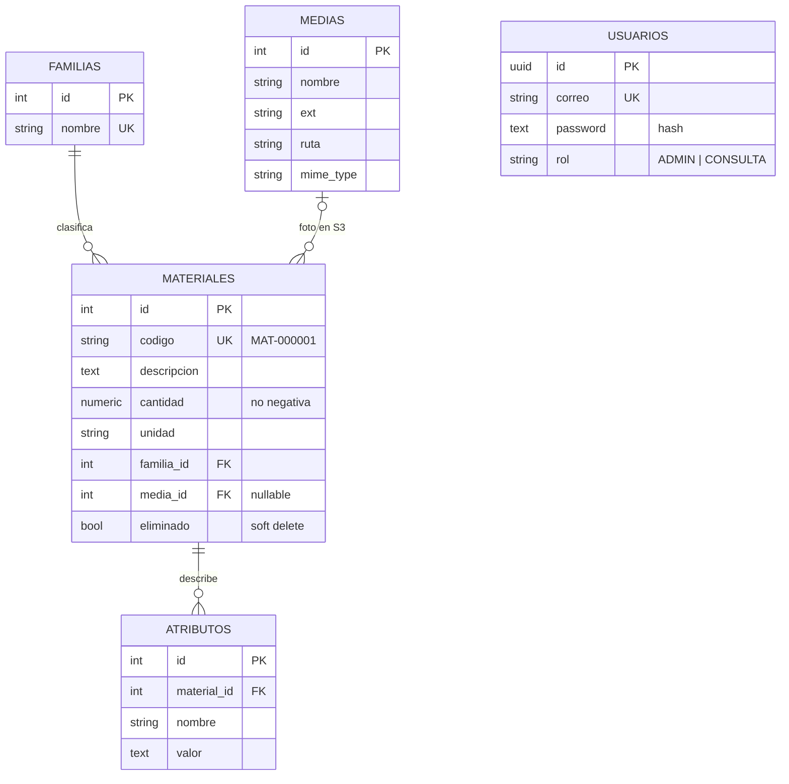

# API de Inventario de Almacén de Mantenimiento — Django

API REST para consultar y gestionar el catálogo de materiales y repuestos de un almacén de mantenimiento industrial (rodamientos, material eléctrico, transmisión mecánica, EPP, etc.), clasificados por familia y con sus especificaciones técnicas.

Proyecto final del módulo **Python Django Advanced** — Desarrollo Web Fullstack, Tecsup.

**Producción:** `https://inventario-almacen-django.onrender.com`

## Stack

| Capa | Tecnología |
|---|---|
| Framework | Django 6.1 + Django REST Framework |
| Base de datos | PostgreSQL |
| Autenticación | JWT con Simple JWT |
| Archivos | AWS S3 con URLs firmadas (boto3) |
| Contenedores | Docker + Docker Compose |
| Servidor de producción | Gunicorn en Render |
| Pruebas de endpoints | Colección de Bruno (`/bruno`) |

## Estructura

```
inventario/   configuración del proyecto (settings, urls)
usuarios/     app de usuarios: modelo propio de auth_user, registro, login JWT, perfil, permisos
catalogo/     app del catálogo: familias, materiales, atributos, paginación, S3
data/         CSV con el inventario inicial (341 materiales, 19 familias, 2701 atributos)
bruno/        colección de Bruno con todas las pruebas
```

## Modelo de datos



## Roles

| Rol | Permisos |
|---|---|
| `CONSULTA` | Consultar familias y materiales. Todo usuario registrado por la API recibe este rol. |
| `ADMIN` | Además crear, modificar, dar de baja, registrar salidas y subir fotos. Es el superusuario (`createsuperuser`). |

## Endpoints

Las rutas del catálogo requieren el header `Authorization: Bearer <token>`.

| Método | Ruta | Acceso | Descripción |
|---|---|---|---|
| GET | `/` | Público | Estado del servicio |
| POST | `/auth/registro` | Público | Registro (rol CONSULTA) |
| POST | `/auth/login` | Público | Devuelve el token de acceso |
| GET | `/auth/perfil` | Autenticado | Datos del usuario del token |
| GET | `/catalogo/familias` | Autenticado | Familias con su total de materiales activos |
| POST | `/catalogo/familias` | ADMIN | Crear familia |
| GET / PUT / DELETE | `/catalogo/familias/<id>` | Autenticado / ADMIN | Detalle, editar, eliminar (409 si tiene materiales) |
| GET | `/catalogo/materiales?pagina=1&cantidad=10&buscar=&familia=` | Autenticado | Listado paginado de materiales activos |
| POST | `/catalogo/materiales` | ADMIN | Crear material (código automático) |
| GET | `/catalogo/materiales/<id>` | Autenticado | Detalle con familia, atributos y url de la foto |
| PATCH | `/catalogo/materiales/<id>` | ADMIN | Modificar campos |
| DELETE | `/catalogo/materiales/<id>` | ADMIN | Baja lógica (soft delete) |
| POST | `/catalogo/materiales/<id>/salida` | ADMIN | Descuenta stock, no permite quedar en negativo |
| POST | `/catalogo/generar-url` | ADMIN | URL firmada para subir una imagen a S3 |
| POST | `/catalogo/materiales/<id>/foto` | ADMIN | Asocia la imagen subida al material |

## Reglas de negocio

- **Baja lógica:** un material eliminado no se borra de la base de datos (`eliminado = true`); deja de aparecer en el listado y en el detalle.
- **Stock:** la cantidad nunca puede ser negativa (validación en el serializer y `CHECK` en la base de datos). La salida de almacén bloquea la fila (`select_for_update`) para que dos salidas simultáneas no dejen el stock en negativo.
- **Familias:** no se puede eliminar una familia que tiene materiales (409).
- **Código:** el código `MAT-xxxxxx` lo genera la API y no se puede modificar.

## Ejecutar con Docker

```powershell
copy .env.example .env      # completar POSTGRES_PASSWORD y DJANGO_SUPERUSER_PASSWORD
docker compose up --build
```

Al arrancar, `iniciar.sh` aplica las migraciones, carga el inventario inicial y crea el administrador. La API queda en `http://localhost:8000`.

## Ejecutar sin Docker

```powershell
python -m venv entorno
entorno\Scripts\activate
pip install -r requirements.txt
copy .env.example .env      # POSTGRES_HOST=localhost
python manage.py migrate
python manage.py cargar_inventario
python manage.py createsuperuser
python manage.py runserver
```

## Fotos en AWS S3

El bucket es privado. La imagen no pasa por el servidor: la API firma una URL temporal y el cliente sube el archivo directo a S3.

1. `POST /catalogo/generar-url` con `{"fileName": "rodamiento", "ext": "jpg", "contentType": "image/jpeg"}`.
2. Subir la imagen a la `url` devuelta (vence en 5 minutos):
   ```powershell
   curl.exe -X PUT -H "Content-Type: image/jpeg" --upload-file rodamiento.jpg "URL_DEVUELTA"
   ```
3. `POST /catalogo/materiales/<id>/foto` con `nombre`, `ext`, `ruta` y `mimeType` del paso 1.
4. `GET /catalogo/materiales/<id>`: el campo `url` abre la foto durante 15 minutos.

## Pruebas con Bruno

Abrir la carpeta `bruno/`, elegir el entorno `Local` o `Produccion` y completar `adminPassword`. Ejecutar en orden: los logins guardan los tokens automáticamente.
